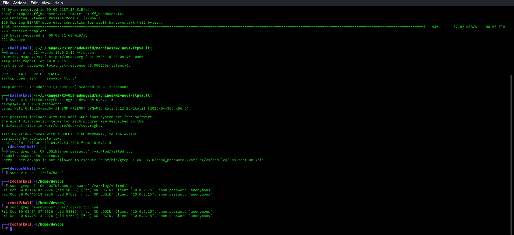
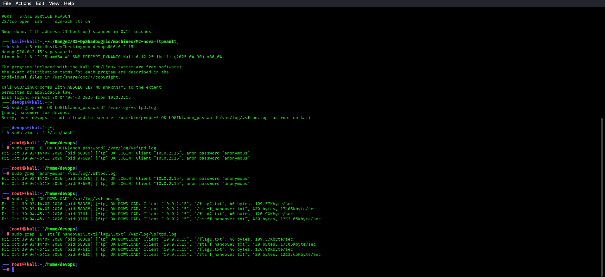

# 🔵 Blue Team — M2: nova-ftpvault Detection Guide

**Challenge:** Anonymous FTP  
**Log Source:** `/var/log/vsftpd.log`

**Validated M2 address for this deployment:** `10.0.2.15`

The log files are on the target host and require root access. On this
deployment, the `devops` account is not permitted to run `grep` through
`sudo`; after that denial was verified, the read-only commands below were
rerun from a root shell on the same host. The root prompt and resulting log
records are shown in the captures.

---

## What to Look For

### 1. Anonymous Login Events

The `vsftpd` log format records this as `OK LOGIN` with `anon_password`, rather than the literal string `ANONYMOUS LOGIN`. The first command below is the working equivalent:

```bash
sudo grep -E 'OK LOGIN|anon_password' /var/log/vsftpd.log
```


```bash
sudo grep "anonymous" /var/log/vsftpd.log
```



Every anonymous login will show source IP, timestamp, and authenticated user ("anonymous").

### 2. File Download Events

```bash
sudo grep "OK DOWNLOAD" /var/log/vsftpd.log
```


```bash
sudo grep -E 'staff_handover\.txt|flag2\.txt' /var/log/vsftpd.log
```



A download of `staff_handover.txt` is the critical indicator — this file contains credentials.

### 3. Correlate with M3 Auth Events

After the FTP download, check M3's systemd journal for an SSH login from the
same source IP within a short window. This combined host has no
`/var/log/auth.log`, so use the journal command that matches M3's live log
source:

```bash
journalctl -u ssh --no-pager | grep -E 'Accepted password|session opened|devops'
```


---

## Remediation

- Set `anonymous_enable=NO` in `/etc/vsftpd.conf` immediately
- Never store credentials in plaintext on shared file systems
- Rotate all credentials exposed via FTP immediately
- Use named FTP accounts with logging enabled
- Consider replacing FTP with SFTP (SSH-based)
