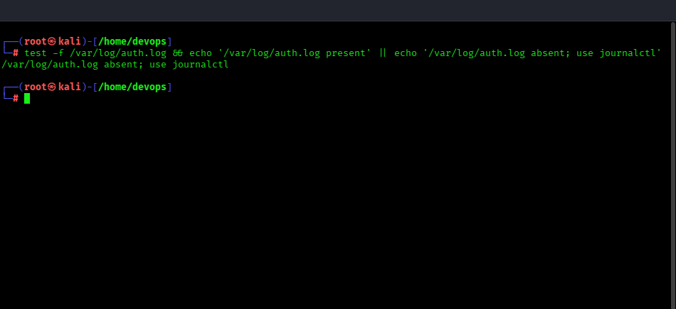
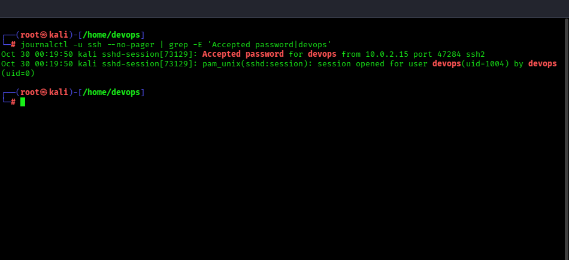
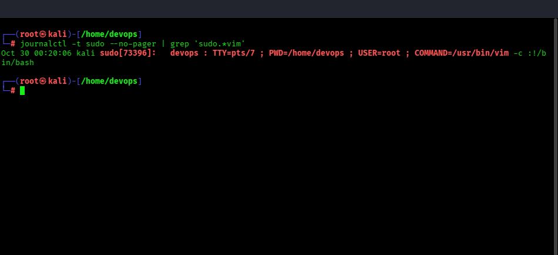
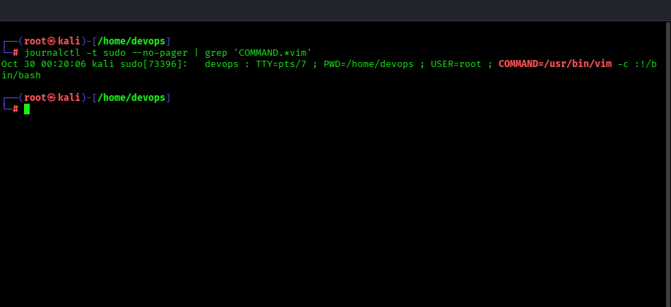
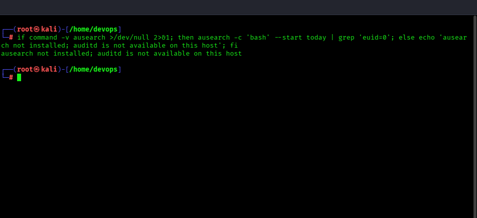
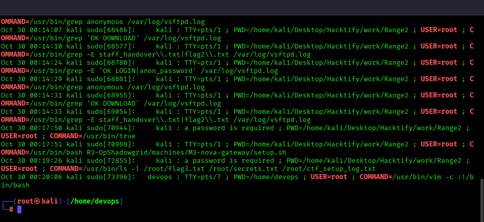

# 🔵 Blue Team — M3: nova-gateway Detection Guide

**Challenge:** Sudo Misconfiguration — vim GTFOBin  
**Log Sources:** `systemd-journald` (`journalctl -u ssh` and `journalctl -t sudo`)

**Validated M3 address for this deployment:** `10.0.2.15`

---

## What to Look For

### 1. Identify the Authentication Log Source

This local Kali host does not create `/var/log/auth.log`; check before using file-based commands:

```bash
test -f /var/log/auth.log && echo '/var/log/auth.log present' || echo '/var/log/auth.log absent; use journalctl'
```



### 2. SSH Login and Sudo Events for vim

```bash
journalctl -u ssh --no-pager | grep -E 'Accepted password|devops'
```



The journal records sudo events under the `sudo` syslog identifier:

```bash
journalctl -t sudo --no-pager | grep 'sudo.*vim'
```



```bash
journalctl -t sudo --no-pager | grep 'COMMAND.*vim'
```



Key pattern:
```
devops : TTY=pts/0 ; PWD=/home/devops ; USER=root ; COMMAND=/usr/bin/vim
```

### 3. Shell Spawned from vim as Root

Check whether auditd is available before using `ausearch`:

```bash
if command -v ausearch >/dev/null 2>&1; then ausearch -c 'bash' --start today | grep 'euid=0'; else echo 'ausearch not installed; auditd is not available on this host'; fi
```



If auditd is enabled, a bash shell with effective UID 0 (root) spawned as a child of
the vim process is the definitive indicator. Auditd is not installed in this local setup,
so the `journalctl -t sudo` command above is the available evidence.

### 4. Subsequent Root Activity

```bash
journalctl -t sudo --no-pager | grep -E 'USER=root|COMMAND='
```



Look for `USER=root` and the vim `COMMAND=` record after the SSH login. Ordinary commands
typed inside the spawned root shell are not recorded by sudo; process auditing is required
if command-level root activity must be reconstructed.

---

## Remediation

- Remove the NOPASSWD sudo rule: `rm /etc/sudoers.d/novatech-devops`
- If vim is needed, restrict it to specific files:
  `devops ALL=(ALL) NOPASSWD: /usr/bin/vim /etc/nginx/nginx.conf`
  (Even this is dangerous — GTFOBins works on file-restricted vim too)
- Better: Use `sudoedit` for config file editing: `devops ALL=(ALL) sudoedit /etc/specific.conf`
- Run `sudo -l` audit across all systems regularly
