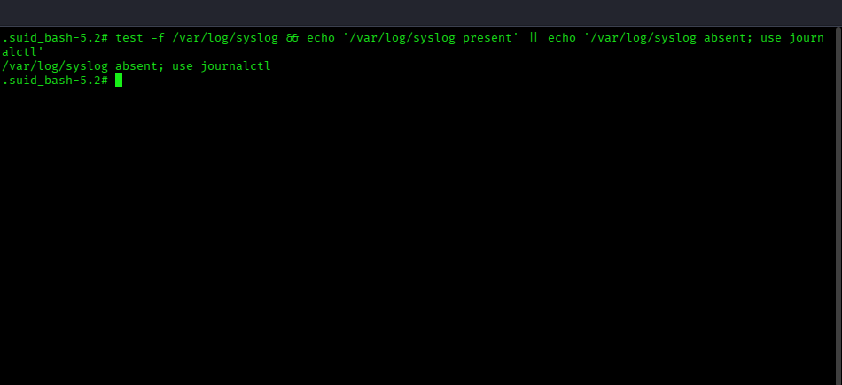
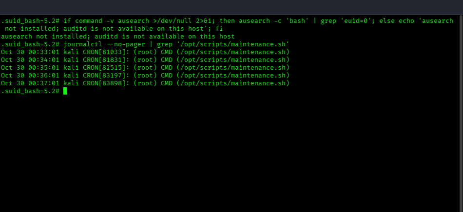
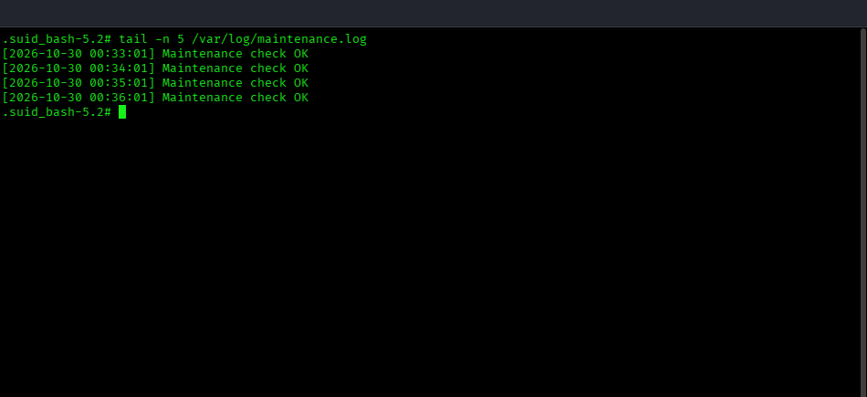
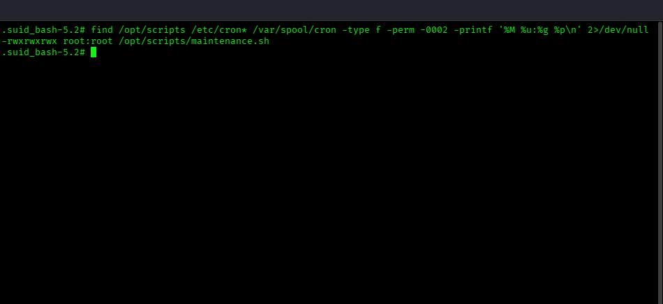
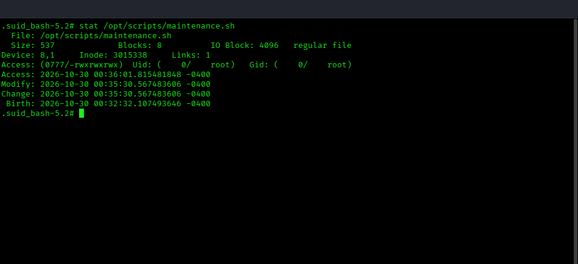
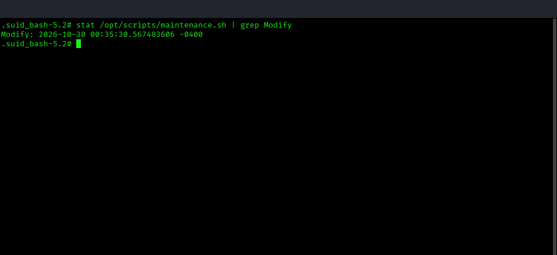
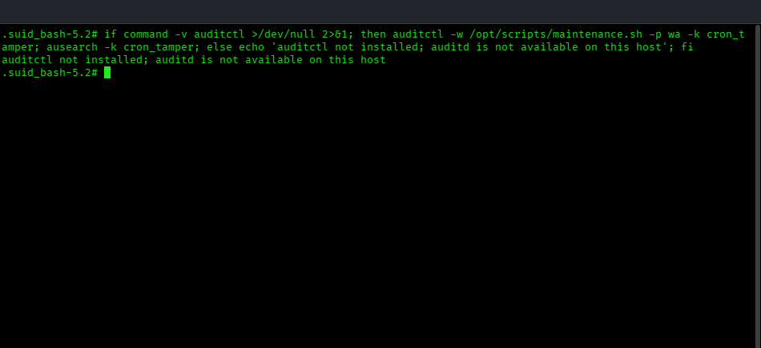
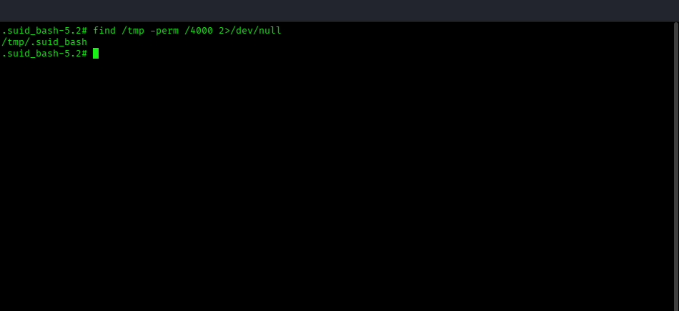
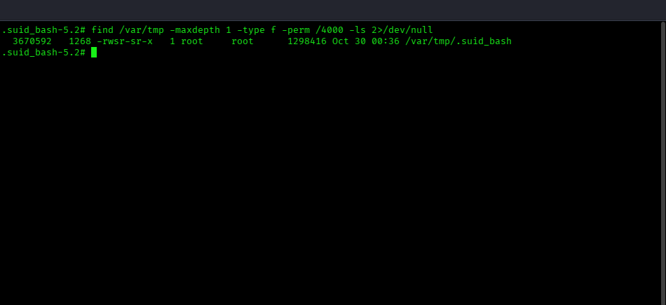
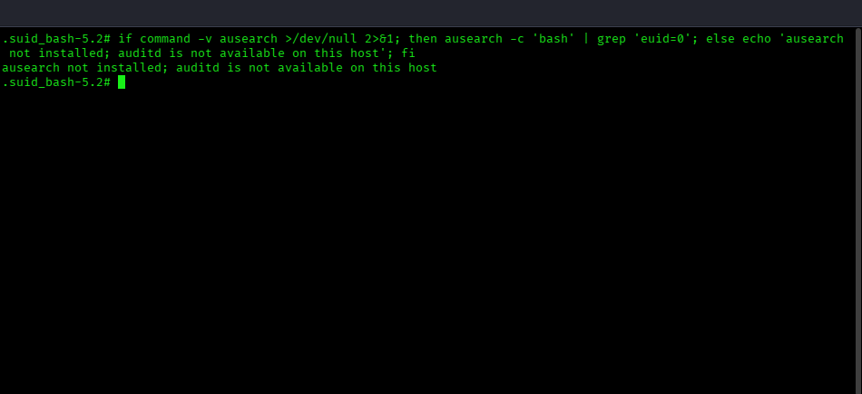

# 🔵 Blue Team — M4: nova-scheduler Detection Guide

**Challenge:** Cron Script Hijacking  
**Log Sources:** `systemd-journald` (`journalctl`), `/var/log/maintenance.log`, and auditd when installed

**Validated M4 address for this deployment:** `10.0.2.15`

---

## What to Look For

### 1. Identify the Cron Log Source

This local Kali host does not create `/var/log/syslog`; use the systemd journal for cron events:

```bash
test -f /var/log/syslog && echo '/var/log/syslog present' || echo '/var/log/syslog absent; use journalctl'
```



### 2. Cron Execution (Baseline)

```bash
journalctl --no-pager | grep '/opt/scripts/maintenance.sh'
```



Normal output is `CRON[xxxx]: (root) CMD (/opt/scripts/maintenance.sh)` every minute. The script's own maintenance output can be checked with:

```bash
tail -n 5 /var/log/maintenance.log
```



### 3. World-Writable Cron Script (Configuration Audit)

```bash
find /opt/scripts /etc/cron* /var/spool/cron -type f -perm -0002 -printf '%M %u:%g %p\n' 2>/dev/null
```



```bash
stat /opt/scripts/maintenance.sh
```



The 777 permission on a root-owned cron script is a **critical misconfiguration**.

### 4. Script Content Change

```bash
# Monitor file modification time
stat /opt/scripts/maintenance.sh | grep Modify
```



If auditd is deployed, watch for writes:

```bash
if command -v auditctl >/dev/null 2>&1; then auditctl -w /opt/scripts/maintenance.sh -p wa -k cron_tamper; ausearch -k cron_tamper; else echo 'auditctl not installed; auditd is not available on this host'; fi
```



### 5. Anomalous SUID Binary in /tmp

```bash
find /tmp -perm /4000 2>/dev/null
```



A SUID binary appearing in `/tmp` is a high-confidence indicator of privilege escalation. On this host, `/tmp` is mounted `nosuid`, so also inspect the validated fallback location:

```bash
find /var/tmp -maxdepth 1 -type f -perm /4000 -ls 2>/dev/null
```



### 6. Root Shell from Unexpected Parent

```bash
if command -v ausearch >/dev/null 2>&1; then ausearch -c 'bash' | grep 'euid=0'; else echo 'ausearch not installed; auditd is not available on this host'; fi
```



Without auditd, use the cron journal and the SUID evidence above to correlate the scheduled root execution with the anomalous binary.

---

## Remediation

- Fix permissions immediately: `chmod 755 /opt/scripts/maintenance.sh`
- Principle of least privilege: cron scripts should not be world-writable
- Regularly audit: `find / -perm -0002 -user root -type f 2>/dev/null`
- Deploy auditd watches on all cron-executed scripts
- Remove SUID binaries from /tmp: `find /tmp -perm /4000 -delete`
