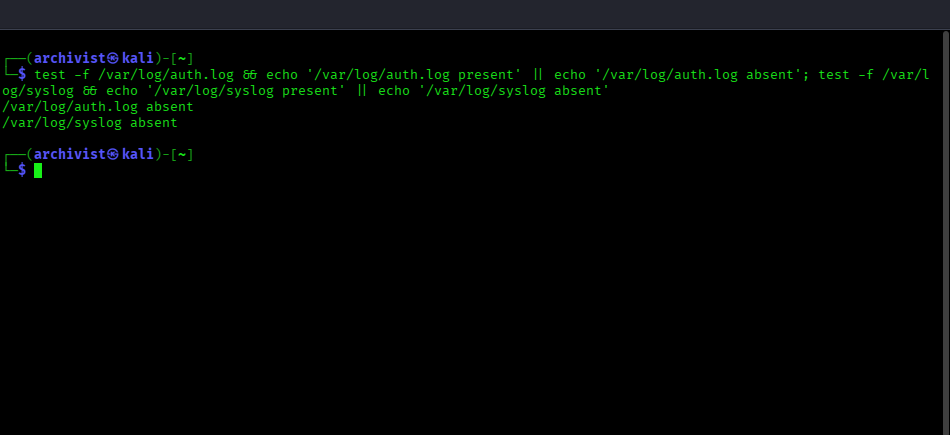
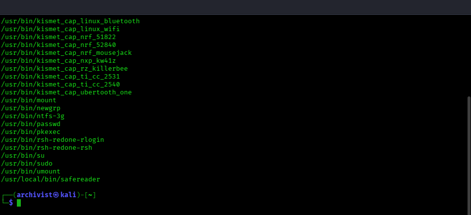
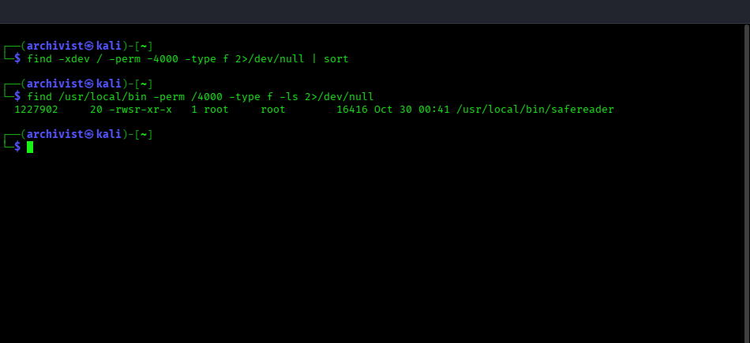
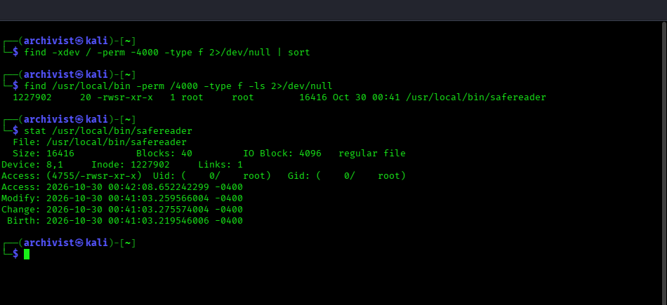
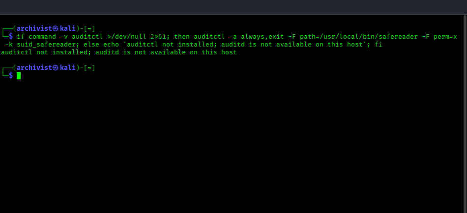
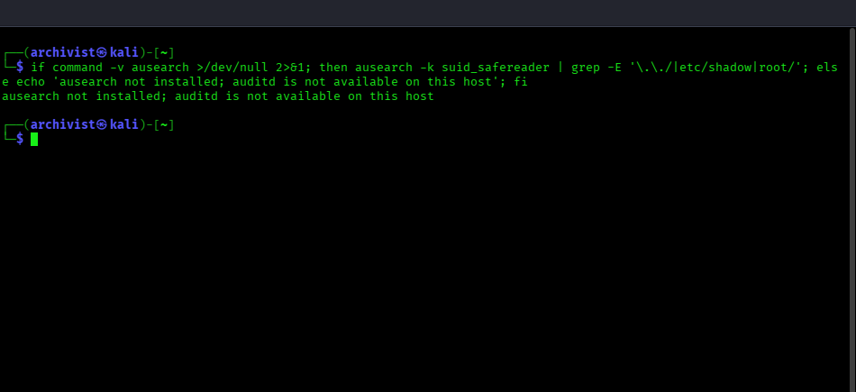
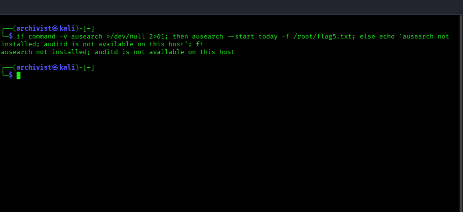
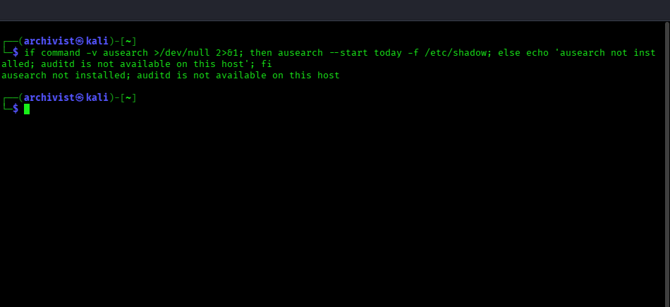

# 🔵 Blue Team — M5: nova-archive Detection Guide

**Challenge:** SUID Binary Path Traversal  
**Log Sources:** auditd when installed; this local host has no `/var/log/auth.log` or `/var/log/syslog`

**Validated M5 address for this deployment:** `10.0.2.15`

---

## What to Look For

### 1. Identify Available Log Sources

Check whether the file-based sources and audit tools exist before using them:

```bash
test -f /var/log/auth.log && echo '/var/log/auth.log present' || echo '/var/log/auth.log absent'; test -f /var/log/syslog && echo '/var/log/syslog present' || echo '/var/log/syslog absent'
```



### 2. SUID Binary Inventory

```bash
find /usr/local/bin /usr/bin /bin -perm /4000 -type f 2>/dev/null | sort
```

The inventory is bounded to executable directories to avoid traversing mounted pseudo-filesystems. Inspect the custom binary directly as well:



```bash
find /usr/local/bin -perm /4000 -type f -ls 2>/dev/null
```



```bash
stat /usr/local/bin/safereader
```



Compare against a known-good baseline. `safereader` should stand out as a
non-standard SUID binary in `/usr/local/bin`.

### 3. Process Execution with Anomalous Arguments (auditd)

```bash
if command -v auditctl >/dev/null 2>&1; then auditctl -a always,exit -F path=/usr/local/bin/safereader -F perm=x -k suid_safereader; else echo 'auditctl not installed; auditd is not available on this host'; fi
```



```bash
if command -v ausearch >/dev/null 2>&1; then ausearch -k suid_safereader | grep -E '\.\./|etc/shadow|root/'; else echo 'ausearch not installed; auditd is not available on this host'; fi
```



Look for arguments containing `../` (traversal) or paths outside `/opt/archive`.

### 4. File Access by Root Process with User Real UID

An auditd record would show: `uid=<archivist_uid> euid=0` when safereader is invoked.
A root-effective process reading `/root/flag5.txt` on behalf of a non-root user is
a strong SUID abuse indicator.

Auditd is unavailable in this local setup, so this condition cannot be reconstructed from logs here; use the SUID inventory and direct execution evidence.

### 5. /etc/shadow or /root Access

```bash
if command -v ausearch >/dev/null 2>&1; then ausearch --start today -f /root/flag5.txt; else echo 'ausearch not installed; auditd is not available on this host'; fi
```



```bash
if command -v ausearch >/dev/null 2>&1; then ausearch --start today -f /etc/shadow; else echo 'ausearch not installed; auditd is not available on this host'; fi
```



---

## Remediation

- Remove SUID bit if not essential: `chmod -s /usr/local/bin/safereader`
- Fix the validation logic: use `realpath()` to resolve the canonical path first, 
  then check with `strncmp()`:
  ```c
  char resolved[PATH_MAX];
  realpath(path, resolved);
  if (strncmp(resolved, APPROVED_DIR, strlen(APPROVED_DIR)) != 0) { // deny }
  ```
- Follow least privilege: run the tool as a dedicated low-privilege service account
- Conduct regular SUID binary audits across the fleet
